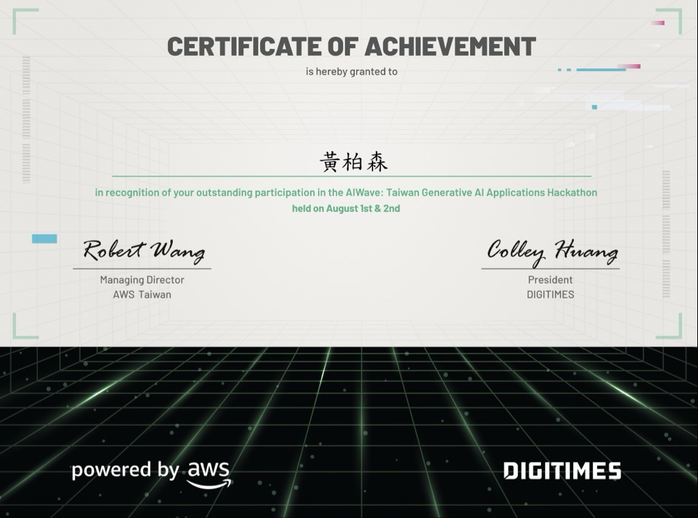
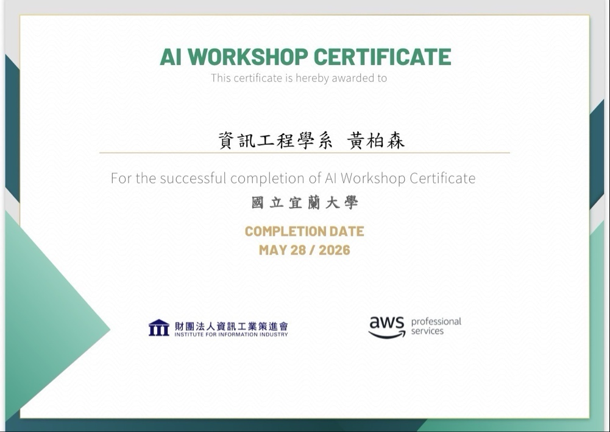

# Boson Portfolio

**Languages:** [English](README.md) · [中文](README.zh-TW.md)

**Live:** <https://boson316.github.io/portfolio/>  
**English:** <https://boson316.github.io/portfolio/en/>  
**Digital card:** <https://boson316.github.io/portfolio/card/> · QR: [`card/qr.png`](card/qr.png)

---

CS junior portfolio — frontend, AI applications, and GPU/CUDA optimization on an RTX 3050 laptop.

[](assets/AIWave_Hackathon_Certificate.png)
[](assets/AI_Workshop_Certificate.png)

## Site features

Single-page portfolio (GitHub Pages) with bilingual UI and interactive sections:

| Section | Anchor | Highlights |
|---------|--------|------------|
| Hero | `#hero` | Intro + **Chat with AI** CTA |
| Flagship research | `#research` | First content section after Hero: multimodal AI research, conceptual architecture, and expandable details |
| Skills | `#skills` | Six skill categories · Canvas visualizations (skill × project graph, CUDA grid, tag sphere, neural net) that filter the project cards |
| Projects | `#projects` | Seven existing engineering projects, starting with GPU Optimization Lab |
| ML showcase | `#ml-showcase` | Wisconsin breast cancer · KNN ~**94.7%** · five Chart.js charts |
| GPU showcase | `#gpu-showcase` | RTX 3050 benchmarks — WMMA GEMM **79–87 % of cuBLAS**, MNIST **98.6 %** |
| Credentials | `#credentials` | AWS AIWave + AI Workshop (lightbox) |
| Contact | `#contact` | Email + AI assistants |

Also: **dark mode** (nav toggle), lazy-loaded Chart.js, responsive layout.

## Current research

The first content section introduces the five-person Multimodal AI for Elderly Care project, Boson's role, and its status: **In development**. It includes two speech results supplied by the owner: recognition processing time from **1.24 to 0.35 seconds** for 5-second audio on October 26 (157 of 162 utterances retained identical transcripts), and actual-reply median **2.43 seconds** over 16 recorded-audio turns on Orin on November 8. The latter is the actual reply start, not a filler phrase. There have been no trials with older adults.

The owner requested a brief introduction while awaiting approval from the advisor and senior teammates. Do not publish model configuration, architecture, facial metrics, detailed experiments, or expandable project details. Review the preview with the owner before updating main directly. No new runtime dependencies or build steps are required.

## AI assistants (dual FAB)

Two floating buttons in the bottom-right corner — same agent persona **小boson**, different backends:

| FAB | Panel | Backend |
|-----|-------|---------|
| **3D** (purple) | `#perxonaPanel` · Perxona avatar | [Perxona Live](https://live.perxona.ai/asia/boson316/littleboson) iframe (default) · SDK + Render proxy fallback |
| **💬** (orange) | `#chatPanel` · text + quick chips | Groq · `POST /api/chat` on [Render API](https://perxona.onrender.com) |

- **apiKey never in frontend** — secrets stay on Render (`api/`).
- 3D knowledge: Perxona Dashboard Storyboard + `perxona-knowledge-base.txt`.
- Text chat knowledge: `api/app.py` `SYSTEM_PROMPT` (Groq).

Full integration notes: [`PERXONA.md`](PERXONA.md) · Backend: [`api/README.md`](api/README.md)

## Achievements & Credentials

| Certificate | Issuer | Date |
|-------------|--------|------|
| **AIWave: Taiwan Generative AI Applications Hackathon** | AWS Taiwan × DIGITIMES | Aug 2026 |
| **AI Workshop Completion** | AWS Professional Services × III @ NIU | May 2026 |

<p align="center">
  <a href="assets/AIWave_Hackathon_Certificate.png">
    
  </a>
</p>

> 2-day generative AI hackathon — Agentic AI workflows, FastAPI integration, model deployment.  
> Also on the [live portfolio](https://boson316.github.io/portfolio/en/#credentials).

<details>
<summary><b>View AI Workshop certificate</b></summary>
<br>



</details>

## Digital card

One short URL / QR for sharing; the page includes **Facebook, Instagram, LinkedIn, YouTube (life / finance), and Vocus blog** icon links:

| Entry | Link |
|-------|------|
| Card page | <https://boson316.github.io/portfolio/card/> |
| Portfolio | <https://boson316.github.io/portfolio/> |
| GitHub Profile | <https://github.com/boson316> |
| FinTools (annual return / retirement) | <https://boson316.github.io/niu/annual_return_calculator_v6.html#calc> |
| Facebook | <https://www.facebook.com/boson.huang.960102> |
| Instagram | <https://www.instagram.com/bosonhuang07/> |
| LinkedIn | <https://www.linkedin.com/in/boson-huang-334b03303/> |
| YouTube · Life | <https://www.youtube.com/@boson0777> |
| YouTube · Finance | <https://www.youtube.com/@Boson0727> |
| Vocus blog | <https://vocus.cc/user/@Boson> |
| Email | poboson316@gmail.com |

Scan or open: <https://boson316.github.io/portfolio/card/> · QR: [`card/qr.png`](card/qr.png)

## Projects

| Project | Link |
|---------|------|
| Multimodal AI for Elderly Care | Research in progress · `#multimodal-research` (available after merge) |
| GPU Optimization Lab | [GitHub](https://github.com/boson316/RTX3050-GPU-Mastery) · [GPU section](https://boson316.github.io/portfolio/en/#gpu-showcase) |
| Annual Return Calculator (CAGR / IRR) | [Calculator v6](https://boson316.github.io/niu/annual_return_calculator_v6.html?lang=en#calc) · [Retirement](https://boson316.github.io/niu/annual_return_calculator_v6.html?lang=en#retire) · [中文](https://boson316.github.io/niu/annual_return_calculator_v6.html#calc) · [GitHub](https://github.com/boson316/niu) |
| Guru 13F Holdings Tracker | [Live](https://us-stock-tracker.boson316.workers.dev/) (Chinese UI) · [Stock lookup](https://us-stock-tracker.boson316.workers.dev/#stock) — source is private |
| News Aggregator | [Live](https://boson316.github.io/news/) · [GitHub](https://github.com/boson316/news) |
| Campus Food Map (4 campuses) | [NIU](https://boson316.github.io/food_map_niu_v2/) · [NTU](https://boson316.github.io/food_map_ntu_v1/) · [NCU](https://boson316.github.io/food_map_ncu_v1/) · [CCU](https://boson316.github.io/food_map_ccu_v1/) · [GitHub](https://github.com/boson316/food_map_niu_v2) |
| ML interactive charts (Wisconsin breast cancer, KNN) | [ML section](https://boson316.github.io/portfolio/en/#ml-showcase) |
| RAG knowledge chat | In progress |

**Contact:** poboson316@gmail.com

## Repo layout

```
portfolio/
├── index.html, en/          # GitHub Pages (static frontend)
├── card/                    # Digital card (social icons + links)
├── script.js                # 💬 Groq text chat
├── perxona-config.js        # Agent ID, API URL (no secrets)
├── perxona-embed.js         # 3D Perxona embed + Live iframe
├── perxona-knowledge-base.* # 3D avatar knowledge (upload .txt to Dashboard)
├── PERXONA.md               # Perxona + Groq integration guide
└── api/                     # Render backend (Root Directory: api)
    ├── app.py               # health, chat, perxona-token, perxona-proxy
    └── README.md
```

## Local preview

**Frontend (static):**

```bash
cd c:\Users\User\Documents\code\cursor\3_Web與API\portfolio
npx serve .
# Card: http://localhost:3000/card/
# English: http://localhost:3000/en/
```

**Backend (optional — for 💬 chat & 3D token on localhost):**

```powershell
cd api
Copy-Item .env.example .env   # fill GROQ_API_KEY, PERXONA_API_KEY
pip install -r requirements.txt
python app.py                 # http://127.0.0.1:5000
```

Set `window.PORTFOLIO_API_URL = 'http://127.0.0.1:5000'` in browser console, or point `perxona-config.js` at your local API.

## License

The site code is released under the [MIT License](LICENSE). Personal content — the résumé text, photos, certificates in `assets/`, and the 小boson knowledge base — is not covered and may not be reused without permission.
